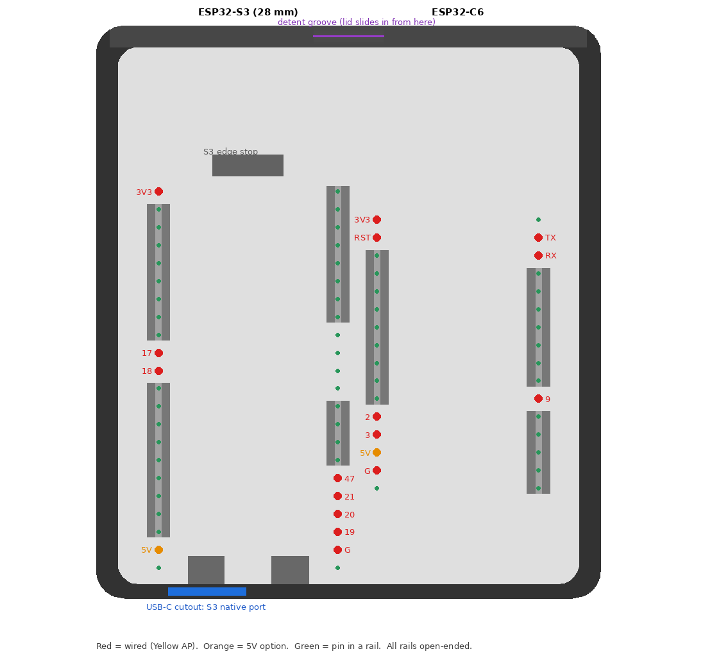

# AP case

A printable case for the [spaghetti AP](../docs/build-an-ap.md): the S3 and C6
boards sit pins-down in slotted rails, the jumper wires run underneath, and a
lid slides in along the top and clicks shut. No screws.



| File | What |
|---|---|
| `ap_base.stl` | The base. Print upright, no supports |
| `ap_lid_flush.stl` | Lid that sits flush with the top. Already oriented top-face-down for printing |
| `ap_lid_inset.stl` | Thinner lid that sits slightly inset; also fits the base |
| `ap_case.scad` | The source ([OpenSCAD](https://openscad.org/) + [BOSL2](https://github.com/BelfrySCAD/BOSL2)) |

Regenerate:

```sh
openscad -o ap_base.stl      -D 'part="base"' ap_case.scad
openscad -o ap_lid_flush.stl -D 'part="lid"' -D lid_flush=true  ap_case.scad
openscad -o ap_lid_inset.stl -D 'part="lid"' -D lid_flush=false ap_case.scad
```

## Fitting the boards

- The boards' header pins drop into 0.6 mm slots with a funnel at the top.
  Wire the jumpers first, then press each board straight down.
- The rails have gaps exactly where the eight jumpers (and both boards' 5V pins)
  come out, for the Yellow AP wiring in [build-an-ap.md](../docs/build-an-ap.md).
  Different boards or wiring mean editing the pin lists in the `.scad`.
- The S3's `USB` port faces the hole in the end wall.
- The flush lid has a channel underneath so it clears the C6's J5 jumper.

## Tuning

- Lid too tight or loose: `lid_c` (clearance per side, default 0.15 mm).
- Click too stiff or weak: `tongue_len`, `ridge_h`.

Derived from hillstub's
[OpenEPaperLink-Minimal-Spaghetti-AP](https://github.com/hillstub/OpenEPaperLink-Minimal-Spaghetti-AP),
MIT licensed ([LICENSE-hillstub](LICENSE-hillstub)).
